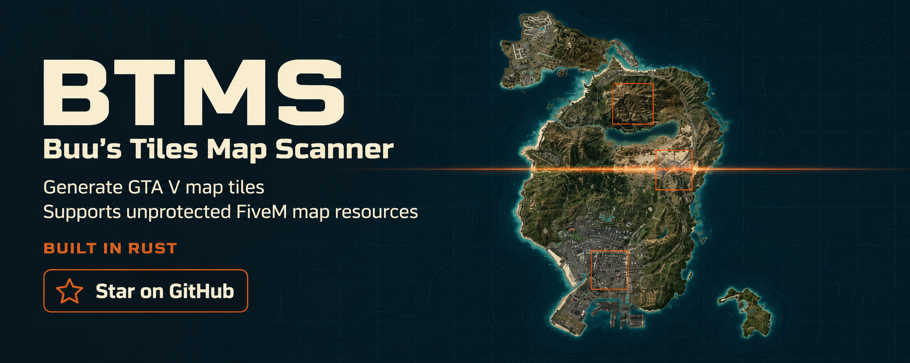
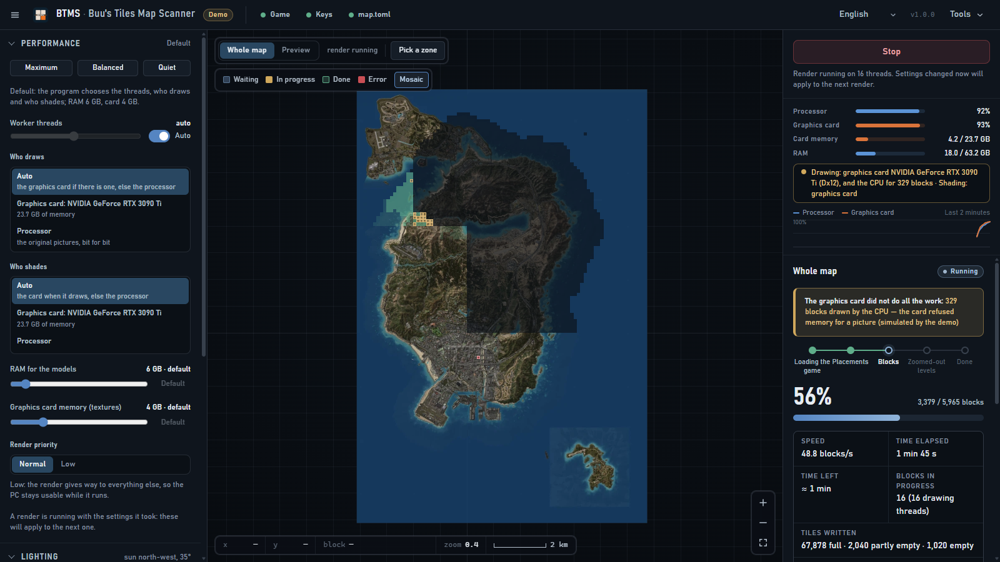
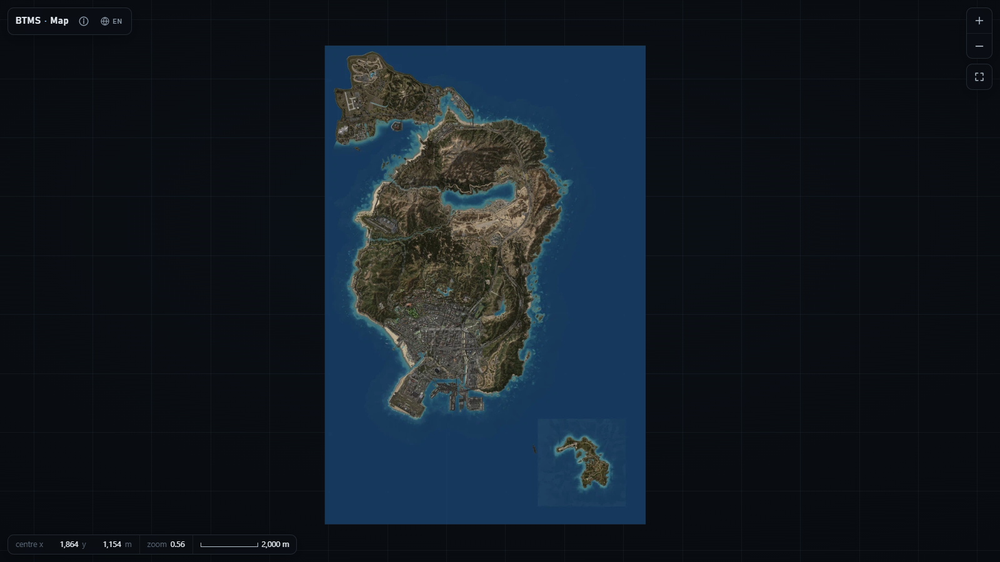

<p align="center"></p>

<p align="center">
  <a href="https://github.com/BuuDevOff/BTMS/actions/workflows/ci.yml"></a>
  <a href="https://github.com/BuuDevOff/BTMS/releases/latest"></a>
  <a href="LICENSE"></a>
  <a href="https://github.com/BuuDevOff/BTMS/releases"></a>
  <a href="https://github.com/BuuDevOff/BTMS/stargazers"></a>
</p>

**BTMS** turns the whole GTA V map into web map tiles, straight from the game files on your disk,
with your FiveM server's unprotected map resources drawn on top. It works offline and read-only,
and writes WebP or JPEG tiles for zooms 0 to 9 with a viewer page you can upload as it is.

## Features

- **Offline and read-only.** BTMS reads the game's `.rpf` archives from disk. It never touches the
  running game or its memory, never writes to the game folder, and talks to no server.
- **Your server's maps.** Streamed `ymap`, `ytyp`, `ydr`, `ydd`, `yft` and `ytd` files replace or
  add to the game's, as FiveM does. Interiors (MLOs) placed by resources are drawn too.
- **Escrow respected.** Protected files (FiveM asset escrow, `FXAP`) are detected, skipped and
  listed. They are never decrypted.
- **GPU-accelerated.** Drawing and shading run on the graphics card through
  [wgpu](https://wgpu.rs) (DirectX 12 or Vulkan), with a processor fallback that draws the same
  picture.
- **Sun and water.** Slope shading, cast shadows and ambient occlusion with an adjustable sun; the
  sea, lakes, rivers and pools.
- **Updates, not full renders.** After a full render, BTMS redraws only the 128 m blocks that your
  resource changes touch.
- **Ready to publish.** Tiles, a `tiles.json` manifest and a standalone `index.html` viewer in one
  folder: upload it and your map is online.
- **A local interface in 7 languages.** Settings, live map, progress and machine load on one page,
  in English, Français, Deutsch, Nederlands, Русский, Svenska and Español.

## Screenshots

<p align="center">
  
  
</p>

## Download and install

You need Windows 10 or 11 (64-bit) and a legal copy of GTA V for PC (the Legacy edition that FiveM
uses). Get BTMS from the [latest release](https://github.com/BuuDevOff/BTMS/releases/latest):

- **Installer** `BTMS-Setup-<version>-x64.exe` (recommended): for your user without administrator
  rights, or for all users. Start menu shortcut, optional desktop icon and PATH entry, and a
  working folder `Documents\BTMS` with a copy of `map.toml`.
- **Portable** `BTMS-<version>-x64-portable.zip`: unzip into a folder of its own and double-click
  `btms-gui.exe` for the interface (`btms.exe` is the command line).
- **Keys:** the installer's option **Set up the keys now** (ticked by default) downloads
  `magic.dat` from [CodeWalker's official GitHub](https://github.com/dexyfex/CodeWalker) and imports
  the keys. BTMS itself never ships `magic.dat` or any key. With the zip, or if that step fails (no
  network, or GTA V not found through FiveM), use **Import magic.dat…** in the interface or
  `btms import-keys <magic.dat>` (add `--game <GTA V folder>` without FiveM).

The executables are not code-signed yet, so SmartScreen warns once: **More info**, then **Run
anyway**. Each release lists its checksums in `SHA256SUMS.txt`.

## Quick start

1. **Install** BTMS and keep **Set up the keys now** ticked.
2. **Start BTMS** from the Start menu. The three checks of the top bar (**Game**, **Keys**,
   **map.toml**) should be green; click a red one to see how to fix it.
3. **Add your server** (optional): under **What is drawn**, open **Server resources** and click
   **Add a folder…**.
4. **Try a zone:** click **Pick a zone**, draw a rectangle, then **Preview the zone**. It is the
   quickest way to tune the lighting and check your resources.
5. **Render** with **Whole map**. When it is done, **Open the folder**: it holds the tiles,
   `tiles.json` and the viewer page.

From a terminal:

```powershell
btms tiles                                        # the whole map, into .\output\tiles
btms tiles output\test --zone 0,-1536,1024,-512   # one square kilometre of Los Santos
btms help                                         # every command and option
```

`btms` works from any folder with the installer's PATH option; otherwise run `.\btms.exe` from the
BTMS folder. `map.toml` and `output\tiles` are relative to the current folder (the Start menu
shortcut starts in `Documents\BTMS`).

## Use the tiles on your website

Upload the output folder as it is: its `index.html` is a complete map page. To show the tiles in
your own Leaflet or OpenLayers map, see [the tile format](docs/tile-format.md): the grid is in game
metres, not web mercator.

## Documentation

| Guide | What it covers |
|---|---|
| [Getting started](docs/getting-started.md) | install, keys, first render, publishing, updates |
| [Configuration](docs/configuration.md) | every key of `map.toml` |
| [Command line](docs/cli.md) | every command and option |
| [Interface](docs/interface.md) | every part of the interface |
| [Tile format](docs/tile-format.md) | the grid, the files, `tiles.json`, Leaflet and OpenLayers |
| [Architecture](docs/architecture.md) | how BTMS reads the game and draws the map |
| [Troubleshooting](docs/troubleshooting.md) | common problems and how to look into them |

## FAQ

<details>
<summary><b>Is it safe for my FiveM account?</b></summary>

Yes. BTMS is a separate program that reads files on your disk. It does not start, attach to, read
the memory of or inject anything into GTA V or FiveM, and the game can stay closed.
</details>

<details>
<summary><b>Does it work with escrowed maps?</b></summary>

No, and it never will. Escrowed (`FXAP`) files are never decrypted; where the game has a model of
the same name, that one is drawn instead. `btms resources` lists what was skipped and why.
</details>

<details>
<summary><b>Which graphics card do I need?</b></summary>

Any card that wgpu can open with DirectX 12 or Vulkan. Without one, the processor draws the same
picture, only slower. Smaller cards work with fewer threads and a smaller texture budget.
</details>

<details>
<summary><b>Where are the keys stored?</b></summary>

In `%LOCALAPPDATA%\BTMS\keys`, checked against their SHA-1 hashes on import and on every read. They
never leave your machine. Delete the folder to remove them.
</details>

## Contributing

Bug reports, fixes, documentation and translations are welcome: please read
[CONTRIBUTING.md](CONTRIBUTING.md) first. Sign your work: a new file gets your own header with your
name or handle, not the BuuDevOff banner, and every contributor is credited. Thanks to
[everyone who has contributed](https://github.com/BuuDevOff/BTMS/graphs/contributors)!

## Credits and legal

- [CodeWalker](https://github.com/dexyfex/CodeWalker) by **dexyfex**: the `magic.dat` format and
  years of public research into GTA V's file formats.
- [rage-rpf](https://crates.io/crates/rage-rpf): reading the game's RPF archives.
- [wgpu](https://wgpu.rs): rendering on the graphics card.
- [libwebp](https://chromium.googlesource.com/webm/libwebp): the WebP encoder.

BTMS is an independent project, not affiliated with, endorsed by or sponsored by Rockstar Games,
Take-Two Interactive or Cfx.re. It ships no game files and no keys. Respect Rockstar Games' terms
and the licence of every resource you publish tiles of.

## License

BTMS is free software under the GNU General Public License, version 3 only
([GPL-3.0-only](LICENSE)).

---

<p align="center">If BTMS helps you, a ⭐ helps it: <a href="https://github.com/BuuDevOff/BTMS">star it on GitHub</a>.</p>
