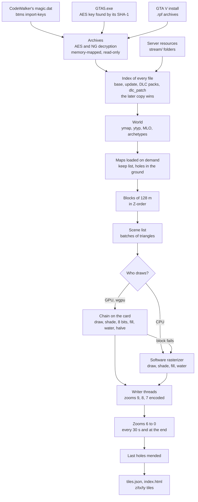

# Architecture

This page follows the data from the game's archives to the tiles on disk. Every module path
refers to `src/`. For the tile grid and the files a render writes, see
[tile-format.md](tile-format.md). For the settings, see [configuration.md](configuration.md).

- [Overview](#overview)
- [1. Reading the game](#1-reading-the-game)
- [2. Which copy of a file wins](#2-which-copy-of-a-file-wins)
- [3. File formats](#3-file-formats)
- [4. The world](#4-the-world)
- [5. Maps loaded on demand, and holes in the ground](#5-maps-loaded-on-demand-and-holes-in-the-ground)
- [6. The server's resources](#6-the-servers-resources)
- [7. Drawing a block](#7-drawing-a-block)
- [8. The GPU renderer and the chain on the card](#8-the-gpu-renderer-and-the-chain-on-the-card)
- [9. Shading](#9-shading)
- [10. Water](#10-water)
- [11. From a block to tiles](#11-from-a-block-to-tiles)
- [12. Zone updates](#12-zone-updates)
- [13. The interface and progress events](#13-the-interface-and-progress-events)
- [Known limits](#known-limits)
- [Module map](#module-map)

## Overview

BTMS reads the game the way a file viewer does. It never attaches to GTA V or FiveM, never reads
their memory, and never writes into the game folder. Everything it draws comes from files on disk:
the game's `.rpf` archives, and the `stream/` folders of the FiveM server resources you point it
at.



## 1. Reading the game

**Install folder** (`game/mod.rs`). BTMS reads `IVPath=` from
`%LOCALAPPDATA%\FiveM\FiveM.app\CitizenFX.ini`, the GTA V folder FiveM uses, and accepts it only
if it holds `GTA5.exe`. `--game <folder>` overrides it. The folder is only read. A `mods/` folder
inside it is skipped.

**Archives** (`game/vfs.rs`, `game/store.rs`). Archives are RPF7, read with the
[`rage-rpf`](https://crates.io/crates/rage-rpf) crate (MIT).

- An archive on disk is mapped into memory, read-only. Nothing is copied: the system reads the
  pages that are asked for. The largest archives weigh several gigabytes.
- An archive inside another one is parsed from the exact slice it occupies, because its NG key
  depends on its own length.
- Each archive is opened once, the first time a path goes through it, and then kept for the
  whole run. Its mapping, decrypted table and folder entries are shared by all threads.

**Keys** (`game/mod.rs`, `game/magic.rs`, `game/hashes/`). No key ships with BTMS, and none is
ever written into the repository or next to the tiles.

- The **AES key** is found in your own `GTA5.exe` by its SHA-1 digest. This happens once; after
  that the key is kept in the keys folder.
- The **NG keys** (101 keys and 272 decrypt tables) are not in any executable on disk. They come
  from CodeWalker's `magic.dat`, which `btms import-keys <magic.dat>` decodes the way CodeWalker
  does. BTMS never ships that file. The Windows installer has a task, ticked by default, that
  downloads it from CodeWalker's official GitHub into the setup's temporary folder and runs
  `btms import-keys` on it; otherwise you import it yourself from your own copy. The decoding:
  1. remove four rounds of a mask drawn from .NET's `System.Random`, seeded with the Jenkins hash
     of the AES key (the generator is reimplemented and tested against .NET);
  2. decrypt with AES-256;
  3. inflate the result (raw DEFLATE).
- **Every key and every table is compared with its SHA-1 digest.** A wrong decoding is refused,
  never used, and the check runs again each time the keys are loaded.
- The keys are kept in `%LOCALAPPDATA%\BTMS\keys` in `rage-rpf`'s own file format:
  `gtav_aes_key.dat`, `gtav_ng_key.dat` and `gtav_ng_decrypt_tables.dat`.
- Until the NG keys are imported, an NG-encrypted archive is refused with an error. It is never
  decrypted with empty keys.

`btms verify` checks the whole chain. It reads a few base, update and DLC archives, decrypts them,
and expects plain XML to come out.

## 2. Which copy of a file wins

The same file name exists in several archives. The game knows a file by its name alone, so the
index (`game/index.rs`) keeps every copy and ranks them, from lowest to highest:

| Rank | Where the copy is |
|---|---|
| 1 (lowest) | the base game (`x64*.rpf` and the other top-level archives) |
| 2 | the patch, `update/update.rpf` |
| 3 | a DLC pack that `dlclist.xml` does not list |
| 4 | each DLC pack in the order `dlclist.xml` loads them, the later pack winning, with each pack's own patch (`update/update.rpf/dlc_patch/<pack>`) ranked just above that pack |
| 5 (highest) | a file streamed by one of the server's resources (see [section 6](#6-the-servers-resources)) |

`dlclist.xml` is read from the patch (`common/data/dlclist.xml`).

Multiplayer packs also swap whole map areas. A pack's `content.xml` can replace the base archive
of a district with its own. Its placement files then carry a prefix (`hei_`, `lr_`, `apa_`, `vw_`,
`bkr_`), so they are not plain copies under the same name. The rule BTMS applies is that the copy
from the pack loaded last is used and the base file is dropped.

## 3. File formats

Everything is parsed in Rust, with checks that turn bad data into an error rather than into a
random read (`formats/`).

- **Resources** (`formats/resource.rs`). An `RSC7` resource is inflated, and its size must be
  exactly the size of its system and graphics pages. Every pointer is checked before it is
  followed.
- **Placements and archetypes** (`formats/ymap.rs`, `formats/meta.rs`). Placements are `.ymap`
  files (`CMapData`: entities placed in the world). Archetypes are `.ytyp` files (`CMapTypes`:
  which model and which textures). Fields are read by name, through the description each file
  gives of its own structures.
- **Interiors** (`formats/mlo.rs`): `CMloArchetypeDef`, with the entities, rooms and portals of
  an interior.
- **Manifests** (`formats/pso.rs`, `formats/rbf.rs`). `_manifest.ymf` files are PSO, and every
  field is read with the type the file declares. Three old base-game manifests are RBF.
- **Models** (`formats/ydr.rs`): `.ydr`, `.ydd` (dictionaries) and `.yft` (fragments), with
  their detail levels, pieces, vertices, triangles and shaders. Every index must be below the
  vertex count. Every vertex must lie inside the archetype's box.
- **Textures** (`formats/ytd.rs`): `.ytd` dictionaries. Formats are DXT1, DXT3, DXT5, ATI1, ATI2,
  BC7 and uncompressed. Each texture's name must match the hash its dictionary gives.

## 4. The world

`World::load` (`world/mod.rs`) builds the map as a whole: the index of every file, every
archetype, the box of every placement file (the copy that wins), and the parent links between
texture dictionaries (`gtxd`). The archives are opened and the files read and parsed on every
logical core (`util/parallel.rs`), then merged in a fixed order. The result does not depend on
the number of threads.

What a render draws from the placements:

- **Every HD entity** (detail level HD or ORPHANHD) of every placement file the game uses,
  whatever its distance from any camera. BTMS does not use the game's distance rule (an HD
  entity near the camera, its LOD stand-in farther away), because a tile is a view from straight
  above at one fixed scale.
- **Each model at its most detailed level.**
- **Rotation.** Entities are turned by the **inverse** of the quaternion stored in the `.ymap`.
  This was checked on the game's own files. For every entity, the archetype's box, turned and
  moved, must fit inside the box the `.ymap` declares. A few thousand entities fit only with the
  inverse, against a few hundred with the stored quaternion as is.
- **Interiors.** The game's interiors are not drawn: they are under a roof. A server resource,
  on the other hand, often uses an interior (`CMloInstanceDef`) for a whole building with a
  glazed or open roof, so a resource's interiors are drawn, unless the resource has a protected
  model (otherwise the furniture would stand alone on the ground). An interior is turned by its
  stored quaternion **as is**, the opposite of an ordinary entity.
- **What is left out:**
  - the folders listed in `[maps] exclude_folders` (North Yankton by default,
    `/levels/gta5/_prologue/`, which only the prologue loads);
  - an entity whose box would span more than 64 blocks (a sky dome, a broken placement);
  - the maps loaded on demand that are not kept (next section).

## 5. Maps loaded on demand, and holes in the ground

**On-demand maps** (`world/groups.rs`). Some maps are loaded only when a script asks for them:
yachts, UFOs, the states of a building that a mission changes. Drawing them all would stack
several states of one place on top of each other. They are marked by bit 0 of the `flags` field
of the file's `CMapData`. Of those, BTMS draws only:

- the files listed in `[maps] keep` (a placement file name; `*` stands for anything);
- the maps of an island listed there: `HeistIsland` keeps the maps that `SET_ISLAND_ENABLED`
  loads, taken from Cayo Perico's `islandhopper.meta`;
- the files a client script of a server resource loads by name (`RequestIpl` with the name
  written out as a string);
- the files whose map group follows the time of day or the weather, as shown at a fixed noon in
  `EXTRASUNNY` weather;
- the LOD parents of a kept file.

A placement file streamed by a server resource is never left out, whatever its bit.

**Holes in the ground** (`world/holes.rs`, `[maps] fill_holes`). The DLC packs moved the ground of
a few places into on-demand maps, so that a script can swap one state of the place for another.
Leaving them out leaves a hole. BTMS finds those holes and closes them:

1. Every 128 m block that an entity of a left-out file touches is drawn with what is kept,
   heights only, at 0.25 m per pixel. Its empty pixels are grouped into regions, joined across
   block edges.
2. A region closed all around by drawn ground is a hole. A region that reaches a block where
   nothing is drawn at all (open sea beyond the seabed) is not, so a yacht moored there stays out.
3. A hole of 4 m² or more is offered to the left-out files that have entities in its blocks, each
   drawn alone. One file that covers 90 % of the hole closes it. The original state of the place
   is tried first. Otherwise several files together close it, the widest first. A state that a
   mission leaves behind (burnt, destroyed) is used only when nothing else closes the hole.
4. A hole that no file closes is reported and left.

These are only the holes in the ground. Two other mechanisms fill pixels later; see
[section 11](#11-from-a-block-to-tiles).

## 6. The server's resources

`world/fivem.rs` reads the FiveM resources listed in `[resources] folders`. A resource is a folder
with an `fxmanifest.lua`. A folder without one is searched for resources, so a category folder
such as `[my-island]` works too.

- **Streamed files win.** Every file under a resource's `stream/` folder replaces the game's file
  of the same name: a placement file, an archetype file, a model or a texture dictionary. A name
  the game does not have is new.
- **Order between resources.** Of two streamed files with the same name, the later one wins.
  Folders are taken in the order of `map.toml`; the resources of a folder, and the files of a
  resource, in the order of their names.
- **What a resource removes:**
  - A placement file with the same name as one of the game's replaces it.
  - In such a file, an entity moved below −2,000 m (the usual way to remove an entity without
    deleting it) is not drawn, and neither is an entity whose archetype only casts a shadow
    (flag `0x800`).
  - A placement file that a client script removes with `RemoveIpl`, the name written out as a
    string, is not drawn. A name the script computes cannot be followed. `CreateModelHide` and
    its variants are reported, not applied.
- **Protected content is reported and left out, never decrypted.** This covers two cases:
  - a file encrypted by FiveM's asset escrow, recognised by its `FXAP` header;
  - a model (`.ydr`, `.ydd`, `.yft`) whose file reads but whose vertices are scrambled. One vertex
    is enough to tell: a coordinate that is not a number, is beyond 100 km, or lies more than
    1 km outside the model's own box.

  Such a model is not drawn, and the game's own model of the same name is drawn instead when
  there is one. Textures, placements and archetypes of the resource are still read.
- **Lenient checks for modding tools.** Some checks are relaxed for files made by modding tools.
  For example, a texture's row pitch, which the game does not read, is not checked in a resource
  file.

`btms resources` lists what the resources hold, replace and remove, and what could not be read.

## 7. Drawing a block

The map is drawn in **blocks of 128 m**, one zoom 7 tile each, on many threads (`tiles/mod.rs`).

- **Picture.** A block is a 2048 × 2048 px picture, 6.25 cm per pixel, seen straight down
  (orthographic) from 3,000 m.
- **Order.** Blocks are taken along a Z-order curve, so that a thread's next block is near its
  last one and the models it needs are probably still loaded.
- **Shared assets** (`render/shared.rs`). Models and textures are loaded once for all threads.
  The first thread that asks for a file loads it, and the others wait for that load. The cache is
  emptied when it passes its budget: 6 GB by default, set with `--ram`. A cached value depends
  only on its key, so a picture never depends on which thread asked first.

Drawing is split in two halves.

**The scene** (`render/scene.rs`, `render/assets.rs`) turns the entities of a view into a list of
batches. Each batch holds vertices already placed in the world, texture coordinates, tints, layer
weights, textures and a drawing mode. The list says nothing about how it will be drawn. Its rules:

- **Passes.** Batches come in three passes: opaque, then cut-out (kept where alpha is at least
  ½), then blended. At equal depth, the later triangle wins. Blended triangles are depth-tested
  with a tolerance of 5 cm and do not write their depth.
- **Colour.** A texture is sampled bilinearly from its first level only, repeated, then
  multiplied by the tint.
- **Palette tints.** Shaders with a palette are tinted by it: the row is the entity's tint, the
  column is a byte of the vertex colour.
- **Terrain.** Terrain shaders mix four layers. The weights come from a mask texture read with
  the second texture coordinates, or from the vertex colours when there is no mask.
- **Texture lookup.** A texture is looked for in the model, then in the archetype's dictionary
  and its parents, then by name in the game's shared `generic` dictionaries. When several shared
  dictionaries hold the name, the best-ranked pack wins.
- **Missing textures.** A piece whose texture cannot be found is drawn plain mid grey.

**The renderer** turns the list into colours and depths. Both renderers fill the same picture
(`render/raster.rs`), so what follows the drawing (shading, hole filling, water, encoding) does
not know which one drew:

- the **CPU renderer** (`render/draw.rs`). It projects each vertex once and tests pixels four at
  a time. Its output is equal, bit for bit, to the reference rasterizer in `render/raster.rs`,
  and tests compare the two on random triangles;
- the **GPU renderer** (`render/gpu/mod.rs`), described next.

## 8. The GPU renderer and the chain on the card

**Which card.** The GPU renderer uses [wgpu](https://wgpu.rs/) on DirectX 12 or Vulkan.

- `--renderer auto` (the default) takes the best adapter: a discrete card before an integrated
  one, and DirectX 12 before Vulkan.
- A software adapter, such as Microsoft Basic Render Driver, is refused under `auto`;
  `--renderer gpu` accepts it when there is nothing else.
- An adapter must be able to blend 32-bit float colours.
- `--renderer cpu` never opens a card.
- The program says once which card draws, or why none does.

**Same result as the CPU, within a tolerance.** The card gets the same list and does what the CPU
does:

- the vertices are projected on the CPU, with the same arithmetic;
- the depth is in metres, in a 32-bit float buffer, with the same "nearer or equal" test and the
  same blending tolerance;
- the four texels around each sample are mixed in the shader with the CPU's formula, not by the
  card's sampler, whose weights have only 8 bits;
- the card moves each vertex onto a grid of 1/256 pixel, and the shader measures that slip and
  takes it back;
- texture coordinates that are not numbers are sent as a marker, so that those pixels get the
  colour the CPU gives them.

The two pictures still cannot be equal to the bit. The card rounds its interpolations its own
way, and a pixel centre lying exactly on an edge belongs to only one triangle on the card. On the
images measured, 99.9 % of pixels are within 2/255 of the CPU and 99.98 % within 8/255. The rest
are single pixels on edges, in foliage, and where two surfaces coincide. Only `--renderer cpu`
gives exactly the processor's pictures.

**Textures on the card.** A texture is uploaded once for all threads. The least recently used
ones leave the card beyond a budget: 4 GB by default, set with `--vram`.

**Fallbacks** keep a render going:

- When no usable card is found, the processor draws everything.
- When the card refuses memory, only that picture goes to the processor. The texture budget then
  drops to three quarters of what it held, and the following pictures are the card's again. The
  card is given up only when it cannot keep even a minimum of textures.
- When the card fails (an error, or the device is lost), the rest of the run is drawn by the
  processor.

**The chain on the card** (`render/gpu/chain.rs`, `render/gpu/shaders/chain.wgsl`,
`tiles/chained.rs`). When the card draws and shades, a block stays on the card from its drawing
to its zooms 9, 8 and 7, which come back in one read:

1. The block is drawn into a picture kept on the card, then the heights around it, first pass
   (what is near the block).
2. The lowest heights of the block's 64 parts are reduced on the card and read back (256 bytes).
   The processor uses them to choose what is tall enough to cast a shadow on the block.
3. That second pass of the margins is drawn over the first, and the nearer value wins.
4. One submission does the rest:
   - the shading;
   - colours multiplied by the shading factors and turned into 8 bits;
   - four passes of hole filling;
   - the ground under the water, the water and the sea;
   - zooms 8 and 7.

   The three pictures come back in one copy, about 21 MB.

Integer steps (hole filling, halving) are bit-exact. Floating-point steps are written so that
the card performs them in the processor's order. For the ground under the water, for example,
each addition goes through integer bits so that the shader compiler cannot reorder it, and the
division by 3 is done in integers on the mantissa. On the blocks measured, the chain gives the
same bytes as the card drawing and shading with the processor doing the rest, apart from at most
1/255 on a few water pixels.

The chain has fallbacks of its own:

- If one block fails (memory refused, a picture not taken, the sea still spreading after its
  last sweep), that block is made again whole on the processor, and the chain goes on.
- If the card fails, is lost, or does not answer within 60 s, the chain is given up. The rest of
  the run goes the way it went without the chain.

Every block made elsewhere than on the card is counted. The count is reported as a progress
event and in a line at the end of the render. `--chain auto|gpu|cpu` controls the chain. `auto`
uses it when the card both draws and shades, or draws with the lighting off.

## 9. Shading

`render/shade.rs` shades the block so that relief and buildings can be read. It uses the
`[lighting]` section of `map.toml` and the `--lighting`, `--azimuth`, `--elevation`, `--strength`,
`--shadows` and `--ambient-occlusion` options. A view from straight above knows the height of
every pixel (the camera height minus the depth). From that height map each pixel gets a factor
that multiplies its colour:

- **Slope.** Lambert's law against flat ground, which keeps its colour exactly. A step steeper
  than 3 to 1 between two pixels is a wall, not a slope. A pixel's slope gives way to the mean
  slope around it when the two are close, so the flat triangles of the ground do not show while a
  roof ridge stays sharp.
- **Cast shadows** (`shadows`). A pixel is in shadow when something on the line toward the sun
  rises above the sun's ray. The search reaches 48 m, and the shadow fades out over the second
  half of that reach, so a tower's shadow ends softly instead of covering the district. A full
  shadow keeps `1 − 0.75 × strength` of the colour.
- **Ambient occlusion** (`ambient_occlusion`). A light darkening at the foot of walls, where
  something rises at more than 45° within 3 m.
- **Foliage** is shaded as a volume, not leaf by leaf. Where heights break from one pixel to the
  next, the slope is the canopy's, and a leaf counts as high as the canopy around it.

**No seams between blocks.** A pixel's factor depends only on the heights within a bounded
distance of it, on grids fixed to the world rather than to the picture. The heights around a
block are drawn into a second picture, heights only (no textures except for cut-outs, nothing
blended). That margin is as wide as the shadow reach toward the sun and a few metres on the other
sides. Only what matters is drawn there: everything within a few metres, and beyond that only
what is tall enough for its shadow to reach the block. Two neighbouring blocks therefore compute
the same factors along their shared edge. A test shades one picture in four pieces and expects
the same result as shading it whole.

**Order.** Shading comes before hole filling, because a hole has no height, and filling copies
the already shaded colours around it.

With `[lighting] enabled = false`, none of this runs and the tiles show the plain texture colours.

**Shading on the card** (`render/gpu/shade.rs`, `render/gpu/shaders/shade.wgsl`). Ten compute
passes follow the processor's code step by step, and most factors are equal to the bit. On a
failure, the processor computes the factors. `--shading auto|gpu|cpu`: `auto` uses the card when
the drawing does.

## 10. Water

`world/water.rs`, `[water] enabled`. The game has two kinds of water, and neither is an ordinary
model.

- **The sea and the lakes** are flat pieces listed in `water.xml`: rectangles and right
  triangles at a height (0 for the sea, about 30 m for the Alamo Sea, higher for the reservoirs).
  Cayo Perico has its own file.
  - **Shallow water.** A tile shows water wherever the ground lies below such a piece. The deeper
    the water, the more opaque and the darker, so the shore fades in.
  - **No ground.** Where there is no ground at all under a piece (beyond the seabed), the region
    is deep water if it touches water or the edge of the block. A pocket ringed by dry ground
    stays empty: a hole in the map is not a pond.
  - **Open sea.** Beyond the rectangles the pieces cover, it is open sea at height 0, as in the
    game.
- **Rivers, pools and fountains** are pieces of models with a water shader. They are drawn as
  blended water. Foam and decals are left out.

With water enabled, the blocks of the sea are drawn too: every block of the rectangle around the
map. Water is never drawn in a heights-only pass, so the shading and the search for holes see the
ground under it.

## 11. From a block to tiles

**Per block.** The steps are the same on the CPU and in the chain on the card:

1. Draw the block (and its margins, when the lighting is on).
2. Shade it.
3. Turn the colours into 8-bit RGBA.
4. **Fill small gaps.** Pixels left empty between two pieces of geometry are filled in four
   passes. Each empty pixel that touches at least three drawn pixels, out of its eight
   neighbours, gets their mean. A wide empty area such as the sea only loses a rim of four pixels.
   This step always runs.
5. Put the water and the sea over the ground under them.
6. Cut the picture into the 16 tiles of zoom 9, halve it to the 4 tiles of zoom 8 and again to
   the tile of zoom 7: **21 tiles per block**. Halving takes the mean of 2 × 2 pixels, weighted
   by alpha.

**Writers** (`tiles/write.rs`). A drawing thread hands its picture to a bounded queue (two
pictures per writer thread) and goes on to the next block. Writer threads do the halving (on the
CPU path), the encoding and the files. When writing lags, the queue fills and the drawing waits,
which gives its cores to the writers. A block counts as done once its 21 tiles are on disk.

Every tile file is written whole: first beside its final name, then renamed over it. A reader
never sees half a tile. An empty tile is not written at all.

**Threads** (`tiles/options.rs`). `--threads auto` gives these drawing threads:

- on the processor alone, one per logical core;
- with the card drawing, half as many again (a thread waiting for its picture leaves its core to
  another);
- with the chain on the card, one per logical core.

`--threads <n>` sets the drawing threads instead. The writer threads follow from them: as many as
the drawing threads with the chain on the card; otherwise one for every two drawing threads for
WebP tiles (the default), and one for every four for JPEG and PNG. There is always at least one
writer thread, and never more than the cores.

**Lower zooms.** Zooms 6 to 0 are made from the zoom 7 tiles, each tile from its four children.
During the render this happens every 30 s for the blocks finished meanwhile, so the map can be
looked at from afar while it fills. It happens once more for every block at the end.

**Last holes** (`tiles/mend.rs`, gated by `[maps] fill_holes`). Some empty regions are closed all
around by what is drawn but filled by no placement file: an opening onto an interior that is not
drawn, or a basin whose water is not drawn. Once the blocks are written, each such region is
found on the zoom 7 tiles, joined across block edges, and coloured from its rim inwards on zoom 9.
The block's tiles are then written again. A region that reaches the outside is the outside (open
sea). A region larger than 2,000 m² is left and reported, because colours spread that far would
not be a map. `btms mend <folder>` runs this pass on its own.

**Encoding** (`tiles/format.rs`, `tiles/webp.rs`, `tiles/jpeg.rs`).

- **WebP** (default). Encoded with libwebp, built from source and linked into the executable.
  - **Lossy** (`--quality` 90 by default): VP8. On a partly empty tile, the alpha plane is
    lossless; an opaque tile has no alpha plane at all.
  - **Lossless:** VP8L.
  - **Effort.** A render encodes fast (method 0, simple RGB-to-YUV conversion). `btms convert`
    encodes with care (method 4, "sharp" YUV conversion).
- **`--format jpeg`:** JPEG quality 82 (4:4:4) for a fully opaque tile, PNG for a partly empty
  one.

**Manifest and page.** `tiles.json` is written at the start of a render with `"complete": false`
and again at the end with `"complete": true`. The viewer page `index.html`
(`web/viewer/index.html`, embedded in the executable) is written next to it, so the folder can
be published as it is. See [tile-format.md](tile-format.md).

**Format of a folder.** A folder has one format. Drawing a `--zone` into a folder that holds tiles
of another format is refused before anything is read, because readers follow the manifest's
`extension` and would then see only the zone. `btms convert` rewrites a finished folder as WebP
into another folder, never in place.

## 12. Zone updates

`btms update` (`update/mod.rs`, `tiles/again.rs`) redraws part of a map that was already drawn,
in that map's own folder, after you add, change or remove a resource. It requires a finished
`tiles.json` (`"complete": true`), except for `--list`, which only reads.

- `--zone x1,y1,x2,y2` redraws the 128 m blocks of a rectangle, rounded outwards.
- `--changes` redraws the ground of every resource added, changed or removed since the last
  record.
- `--list` says what `--changes` would redraw, and draws nothing.
- `--record` records the resources as they are now, and draws nothing.

**No seams.** The blocks are drawn exactly as the full render drew them: the same zone rule for
the hole search and the placements, the same blocks, light and water, and the folder's own
format. Unlike a render into an empty folder:

- a redrawn tile that comes out empty is deleted, and so are the 21 tiles of a block where
  nothing is drawn any more;
- the last holes are looked for from the redrawn blocks, reading neighbouring blocks from the
  folder as the search reaches them;
- zooms 6 to 0 are made again above every block touched, up to zoom 0, and a tile whose children
  are all gone is deleted;
- `tiles.json` stays the map's own. Its limits, block count and resource list follow the change,
  and an entry is added to its list of updates (the last 100 are kept).

**The resources record** (`update/record.rs`) is `resources.json` in the map folder. It is
written at the end of a whole-map `btms tiles` (not with `--zone`), by `--changes`, and by
`--record`. It is not written when blocks failed.

For each resource, the record keeps:

- its name under the resource folders;
- a quick fingerprint of the files that can change the map: the manifest, everything under
  `stream/`, and the `.lua`, `.js`, `.meta`, `.xml` and `.ide` files. Each file is fingerprinted
  by relative path, size and date, not by content;
- the ground it covers, in metres and in 128 m blocks;
- whether its map files could all be read, and why not.

Beside those entries, the record keeps the map settings that affect the whole map (`[maps]`,
`[lighting]`, `[water]`), the last name of each resource folder (no disk path is written, because
the folder is meant to be published), and the on-demand maps the render drew.

**Changes** (`update/ground.rs`). A resource is added, changed or removed; a renamed resource
counts as one removed and one added. Its ground is everything it touches on the map:

- the entities of the placement files it streams (the winning copy of each name), boxed by their
  archetypes, interiors included;
- the entities of the game's files it replaces;
- the files its scripts remove or load by name;
- wherever on the map its streamed models and texture dictionaries are placed.

BTMS redraws the old and the new ground of each changed resource, plus any on-demand map now
drawn differently. That area is widened by one block, or more when shadows reach further.

When the `[maps]`, `[lighting]` or `[water]` settings no longer match the record, `--changes` is
refused, because redrawing part of the map with other settings would leave a seam: draw the whole
map again instead. `--record` records the current settings. `--zone` only reports the mismatch,
and draws.

**One writer per folder** (`update/lock.rs`). `btms tiles` and `btms update` hold a lock file,
`write.lock`, in the folder for as long as they write (`update --list` writes nothing and takes
none). It records the process number, the program, the command and the start time (`pid`,
`program`, `command`, `since`). A folder being written by another live process is refused. A lock whose process is gone, or whose process number now belongs to another
program, is stale and is taken over.

## 13. The interface and progress events

The interface (`interface/`) is a small HTTP server on 127.0.0.1 that serves a page embedded in the
executable (`web/interface/`). Each job (a render, an update, a report) runs as a child process of
the same executable, because a run's configuration is set once per process. A child started by
the interface has `BTMS_PROGRESS=1` and writes progress events on its standard output as lines
starting with `@@BTMS ` followed by JSON (`progress.rs`). The server reads them to show phases,
blocks, rates and fallbacks. The child watches its standard input and stops when the interface
goes away. See [interface.md](interface.md).

`btms probe <bx> <by>` (`probe.rs`) explains what one 128 m block is made of. It lists the models
drawn, what is left out and why, and the empty, near-black and plain grey pixels of the block
drawn in memory. See [troubleshooting.md](troubleshooting.md#black-or-grey-patches).

## Known limits

These are stated in the sources as not done yet, or as deliberate choices:

- The rendering shows the texture colours shaded by an adjustable sun. It is not the game's own
  lighting, and visual mods installed on a client are not part of it.
- High-definition texture dictionaries (`+hi`) are not used, so textures are less sharp than in
  the game.
- The "overlay" archives of patch packs are not followed.
- A handful of `.ymap` and `.ytyp` files stored as PSO are not read.
- Half-float vertices are not supported. No model read so far had them.
- A few models have texture coordinates that are not numbers. Both renderers draw those pixels
  black, which leaves small dark patches a few metres wide.
- Maps that follow the time of day or the weather are shown as at noon in `EXTRASUNNY`.
- Close to the world axes (x or y within 128 m of 0), widening the shading margins changes a few
  pixels by a few levels out of 255. The probable cause is the rounding of 32-bit floats near
  small coordinates; this is not proven.
- The ground of a resource whose models are protected cannot be drawn. The tiles show the game's
  own ground there, or nothing.

## Module map

```
src/
├─ main.rs              btms.exe, the command line: calls btms::cli::main()
├─ bin/btms-gui.rs      btms-gui.exe: the same main() built as a Windows application, so the
│                       interface opens with no console window (Start menu, desktop, portable zip)
├─ lib.rs               module tree
├─ cli/                 commands, global flags, help; archive.rs: verify, ls, extract, find
├─ config.rs            map.toml
├─ progress.rs          progress events for the interface (@@BTMS lines)
├─ probe.rs             btms probe
├─ game/                install folder and keys (mod.rs), magic.dat (magic.rs), key digests (hashes/),
│                       archives (vfs.rs), file index and precedence (index.rs), archive cache (store.rs)
├─ formats/             rbf, resource, meta, pso, ymap, ydr, ytd, mlo
├─ world/               World::load (mod.rs), server resources (fivem.rs), on-demand maps (groups.rs),
│                       holes in the ground (holes.rs), water (water.rs), btms resources (resources.rs)
├─ render/              raster.rs (reference), draw.rs (CPU), scene.rs, assets.rs, shared.rs, shade.rs
│  └─ gpu/              mod.rs (drawing), shade.rs, chain.rs, shaders/{shade.wgsl, chain.wgsl}
├─ tiles/               mod.rs (btms tiles), write.rs, format.rs, webp.rs, jpeg.rs, options.rs,
│                       chained.rs, mend.rs, convert.rs, again.rs
├─ update/              mod.rs (btms update), record.rs, ground.rs, lock.rs
├─ interface/           the local server: mod.rs, instance.rs, job.rs, machine.rs, settings.rs, sources.rs
└─ util/                parallel.rs, profile.rs
web/
├─ interface/           the page of the interface (embedded)
└─ viewer/index.html    the standalone viewer copied next to tiles.json
```
