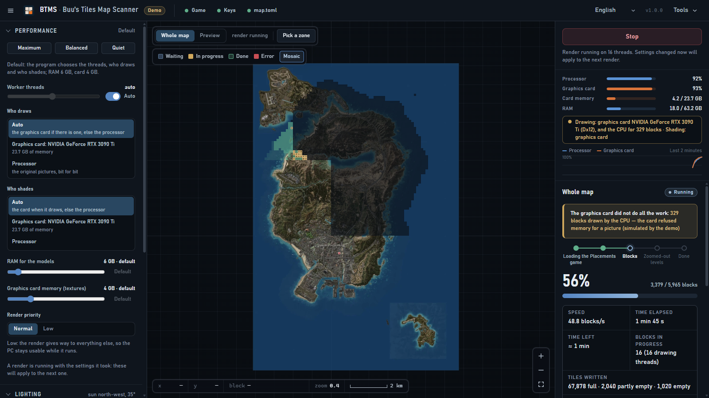

# The interface

BTMS comes with a local interface: a page served by BTMS itself and opened in a window of
its own. From it you set up, start and follow every render without typing a command. It runs the
same commands you could type yourself (see [cli.md](cli.md)); it only builds the command lines for
you.



- [Opening it](#opening-it)
- [The window at a glance](#the-window-at-a-glance)
- [Top bar](#top-bar)
- [Settings column](#settings-column)
- [The map](#the-map)
- [Starting a job](#starting-a-job)
- [Following a job](#following-a-job)
- [When the graphics card falls back to the processor](#when-the-graphics-card-falls-back-to-the-processor)
- [Resource changes and map updates](#resource-changes-and-map-updates)
- [Where the settings are kept](#where-the-settings-are-kept)
- [Security](#security)
- [When it stops](#when-it-stops)

## Opening it

Use the **BTMS** shortcut in the Start menu, or double-click `btms-gui.exe` in the portable
folder: the interface opens with no console window. In a terminal, run `btms` with no command, or
write it out:

```
btms interface [--port <n>] [--no-window]
```

- The page is served on `http://127.0.0.1:8791/`. If that port is taken, BTMS tries the next 20.
  Run in a terminal, `btms interface` prints the address it got.
- The window is Microsoft Edge in app mode when Edge is installed, otherwise your default browser.
  With `--no-window`, no window opens: open the printed address yourself.
- One interface runs at a time. Starting BTMS again, even with its window closed and a render
  running, opens a window on the running one instead of starting a second server.
- Closing the window does not stop a render.
- The page is built into the executable: no Node.js, no extra files, nothing loaded from the
  network.

`btms interface --render-line [x1,y1,x2,y2]` starts no server. It prints, as a JSON array, the
arguments of the render the interface would start with its current settings (for that zone, or
the whole map without one), writes the derived configuration they name, and renders nothing. Use
it to check a command line, for example with `btms tiles … --dry-run`.

**Demo mode.** Add `?demo=1` to the address (`http://127.0.0.1:8791/?demo=1`) to try the window
against a fake server built into the page. A **Demo** badge shows in the top bar. Nothing reads
the game and nothing is written: a render is only a timer. It is handy for screenshots,
translations and work on the page.

## The window at a glance

| Where | What |
|---|---|
| Top bar | the logo, the three checks (game, keys, config), the language, the version and the **Tools** menu |
| Left column | the settings: performance, lighting, what is drawn, folders and tile format |
| Centre | the live map: your tiles, the zone you pick, the progress mosaic of a render |
| Right column | the start buttons, the machine load, the progress, the resource changes and the log |

The **Settings** button at the far left of the top bar shows or hides the settings column. A
narrow window (1180 px or less) starts with it folded. Sections you fold stay folded next time.

## Top bar

From left to right: the **Settings** button, the BTMS logo and name, the three checks, the
language selector, the version and the **Tools** menu.

### The three checks

Three buttons, green or red, tell you whether a render can start:

| Check | Green when |
|---|---|
| **Game** | the GTA V folder is found. By default BTMS takes the folder FiveM uses, from FiveM's own settings |
| **Keys** | the decryption keys are imported and valid |
| **map.toml** | the map configuration file can be read |

Click a check to open its card: a title (**Game folder**, **Decryption keys** or **map.toml**), a
badge (**OK** or **Needs fixing**), what BTMS found, the path, and the actions that fix it.

- **Game.** **Choose the game folder…** opens the folder dialog: pick the folder that holds
  `GTA5.exe`. Once you have picked one, **Back to FiveM's game folder** returns to the default.
- **Keys.** **Import magic.dat…** asks for the `magic.dat` file of CodeWalker and runs
  `btms import-keys` on it. Its output goes to [the log](#the-log), and the check turns green
  once the keys are in place. The import reads a key from your `GTA5.exe`, so fix the **Game**
  check first. The button is disabled while a job runs.
  - If you used the installer with its task **Set up the keys now: download magic.dat from
    CodeWalker's official GitHub** (ticked by default), the keys are normally already there. Use
    this button when that step failed or was skipped.
  - Otherwise, take `magic.dat` from your own copy of
    [CodeWalker](https://github.com/dexyfex/CodeWalker) (in its repository:
    `CodeWalker.Core/Resources/magic.dat`). BTMS does not ship `magic.dat` or the keys.
  - The keys are kept in `%LOCALAPPDATA%\BTMS\keys` and checked against their SHA-1 hashes each
    time they are read.
- **map.toml.** **Open map.toml** opens the file in its default editor. **Choose another file…**
  points the interface at another configuration file.

Each failed check also adds a red line under the top bar (**Game folder not found.**, **Keys
missing.** or **map.toml cannot be read.**) with BTMS's explanation and the first action that fixes
it. While a check fails, no render can start, and the note under the start buttons says why. An
unreadable `map.toml` blocks renders on purpose: a render with the defaults in place of your
settings would be worse than no render.

### Language

The selector just before the version lists the seven languages of the interface by their own
names: English, Français, Deutsch, Nederlands, Русский, Svenska and Español. Until you pick one,
the interface follows your browser's preferred languages, and falls back to English. BTMS keeps
your choice itself, so it survives a change of port. Messages from BTMS (the checks, refusals and
errors) are translated too. These stay in English:

- the lines of [the log](#the-log);
- the reasons of a
  [graphics-card fallback](#when-the-graphics-card-falls-back-to-the-processor);
- a failed job's own error line, or its exit code;
- the note of **Resource changes** and the reasons given for its resources;
- details that come from a file or from the system, such as a path, an error in `map.toml` or a
  Windows error.

### Tools menu

**Tools** runs reports. They draw nothing and change nothing, and their text arrives in
[the log](#the-log). The reports are disabled while a job runs.

| Item | Command | What it tells you |
|---|---|---|
| **Check the game and the keys** | `btms verify` | whether the game folder and the keys work: it opens a few game archives and decrypts files from them |
| **On-demand maps report** | `btms groups` | which on-demand maps are kept, which are left out, and why |
| **Server resources inventory** | `btms resources` | your resources, the game files they replace, names streamed twice, and the files left out (protected ones included) |
| **Quit** | | stops BTMS after a confirmation, and the running job with it. Tiles already written stay on disk |

After **Quit**, the page says **BTMS has stopped** and you can close the window.

### When the connection is lost

If BTMS stops answering, a red banner says **Connection lost.** and the page keeps retrying.
Settings you change meanwhile are sent when it answers again. If BTMS was restarted, the page
reloads itself once to pick up the new session; if that is not enough, it asks you to close the
window and start BTMS again.

## Settings column

Settings are saved a moment after you change them, and the line at the bottom of the column says
**Settings saved.** or why a change was refused. They apply to the next job: a running render
keeps the settings it started with.

The interface never rewrites `map.toml`, so your comments in it are safe. What you change in
**Lighting** and **What is drawn** is kept apart as overrides, and each job gets a derived copy of
`map.toml` with them applied. A setting that differs from the file is marked **Differs from
map.toml: …** with both values, and **Back to map.toml** drops the override. A section header
is highlighted when one of its settings differs from `map.toml`.

### Performance

Three presets set everything at once:

| Preset | Threads | Who draws, who shades | Memory budgets | Priority |
|---|---|---|---|---|
| **Maximum** | auto | the graphics card, if there is one | half the RAM; half the card's memory, less if its threads and the shading need the room | normal |
| **Balanced** | logical cores − 2 | auto, auto | the defaults (6 GB, 4 GB) | normal |
| **Quiet** | half the logical cores | auto, processor | the defaults | low |

The section header names the preset in use, **Default** while nothing was touched, or **Custom**
once you change a setting by hand.

- **Worker threads**: 1 to twice the number of logical cores, or **Auto** to let BTMS pick enough
  threads to keep every core and the graphics card busy.
- **Who draws**: **Auto** (the graphics card if there is one, else the processor), **Graphics
  card: \<name\>** (with its memory), or **Processor** (the reference renderer).
- **Who shades**: **Auto** (the card when it draws, else the processor), the graphics card, or
  **Processor**.
- **RAM for the models**: how much RAM the loaded models and textures may take, shared by all
  threads. Beyond it they are dropped and loaded again when needed. **Default** means 6 GB.
- **Graphics card memory (textures)**: the texture budget on the graphics card. **Default** means 4 GB. A
  render also keeps its own pictures and the shading on the card, so the slider stops at what the
  card can hold beside them. A warning says when the value is too high, or when other programs
  already hold too much of the card.
- **Render priority**: **Normal** or **Low**. Low keeps the PC usable while a render runs. It
  applies to renders and updates, not to reports.

Each of these becomes an option of the job's command line (`--threads`, `--renderer`,
`--shading`, `--ram`, `--vram`); the memory budgets only when you set them.

### Lighting

- **Shade the tiles** turns the sun shading on or off. Off, the tiles show plain colours.
- **Low sun — 35°, strength 0.6** (strong relief, darker streets) and **High sun — 45°, strength
  0.5** (shaded streets easier to read) set the elevation and strength at once.
- **Sun azimuth** (0° to 360°, with a small compass), **Sun elevation** (10° to 80°), **Shading
  strength** (0 to 1), **Ambient occlusion** (the darkening at the foot of walls, 0 to 1) and **Cast
  shadows** (shadows of buildings, trees and terrain).

These are the `[lighting]` keys of `map.toml` (`azimuth`, `elevation`, `strength`,
`ambient_occlusion`, `shadows`); see [configuration.md](configuration.md).

### What is drawn

- **Water**: the sea, lakes, rivers and pools. Off, the tiles show the ground under the water.
- **Fill the holes in the ground**: also keeps the on-demand maps without which the ground has a hole,
  such as the original state of a place that a DLC remade.
- **On-demand maps kept**: the game loads some maps only when a script asks for them (yachts, the
  states of a building a mission changes). They are left out, except the ones in this list. One
  name per line; `*` matches anything. **Show and edit the list** unfolds it.
- **Excluded game folders**: game folders whose placement files are never drawn, one per line.
- **Server resources**: your FiveM resource folders, or folders of resources such as `[maps]`.
  Their streamed files win over the game's files of the same name; between two resources, the
  last folder wins. **Add a folder…** opens the folder dialog. Untick a folder to leave it out of
  the render without forgetting it, or remove a folder added here with its **×** button. With no
  folder, the list says **No folder: only the game is drawn.**
- At the bottom: the configuration file in use, and **Open map.toml**.

These are the `[water]`, `[maps]` and `[resources]` sections of `map.toml`.

### Folders and format

- **Tile format**: **WebP** (the default: one kind of file, transparency included, made for the
  web) or **JPEG and PNG** (JPEG for full tiles, PNG for partly empty ones; no quality setting).
- **WebP quality**: 50 to 100, 90 by default, or **Lossless** (every pixel exactly as drawn, files
  several times heavier: for archiving rather than publishing). **Default** goes back to 90.
- **Whole map folder** (`output/tiles` by default), with **Change…** and **Open**. A whole-map
  render writes over the tiles already there.
- **Preview folder** (`output/preview` by default), with **Change…** and **Open**. It is emptied
  before each preview, with care: only when it is empty or holds a BTMS `tiles.json`, and then only
  `tiles.json`, `index.html` and the zoom folders `0` to `9` are removed. A folder that is, holds
  or sits inside the whole map folder, or that holds a whole-map render, is refused, and nothing
  is deleted.

The folder buttons are disabled while a job runs.

## The map

The centre of the window shows your tiles on the game's own grid: zooms 0 to 9, 512 px tiles,
blocks of 128 m (see [tile-format.md](tile-format.md)).

**Moving around.** Drag to move; scroll to zoom; double-click to zoom in (Shift + double-click to
zoom out). With the map focused, `+` and `-` zoom and the arrow keys move. The side buttons are
**Zoom in**, **Zoom out** and **Show everything**. The bar at the bottom shows the game coordinates under
the pointer (**x**, **y**, in metres), the **block**, the **zoom** and a scale. The view is
remembered.

**What is shown.** **Whole map** / **Preview** switches between the tiles of the two folders.
Beside it, the state of that folder: **no tiles**, its number of blocks, **complete**,
**incomplete**, **render running** or **update running**; hover it to see the path. Under a
preview, the whole map stays faintly visible so you can see where the zone is.

**Picking a zone.** Click **Pick a zone** and draw a rectangle, or hold Shift and drag anywhere.
The zone snaps to the 128 m blocks; `Esc` cancels. Drag an edge or a corner to resize it. **Show
the zone** frames it, **Clear** removes it. The note under the start buttons gives its size in
blocks and metres, and an estimated duration once a render has measured a speed.

**During a render.** A mosaic covers the render's plan, one square per block: **Waiting**, **In
progress**, **Done** or **Error**. **Mosaic** shows or hides it. Each finished block shows through
at once, and the far zooms (6 to 0) are rebuilt about every 30 seconds, so the whole map fills in
as you watch. Hover a block in error to read its message.

## Starting a job

The right column starts with the buttons:

- **Preview the zone** renders the zone you picked into the preview folder, replacing the previous
  preview there. Fast: use it to try settings and check your resources.
- **Whole map** renders the whole map into the whole map folder. A confirmation, **Render the
  whole map?**, shows the folder, warns that the tiles already there will be rewritten and gives
  an estimate (about 6,100 blocks; the estimate needs the speed of an earlier render, a zone
  preview is enough).
- **Update the map here** redraws the zone you picked inside the whole map itself. The rest of the
  map does not change. See [Resource changes and map updates](#resource-changes-and-map-updates).
- **Stop** takes their place while a job runs. It asks first (**Stop** or **Continue**). Tiles
  already written stay, but a stopped render does not resume where it was. A stopped update
  leaves the blocks it redrew in the map: run it again to finish.

The note under the buttons says what a click would do, what is running, or why nothing can start.
One job runs at a time, each in its own process of the BTMS executable that opened the interface
(`btms-gui.exe` from the Start menu, `btms.exe` from a terminal).

## Following a job

### Machine load

Always visible under the buttons, job or not:

- four gauges: **Processor**, **Graphics card**, **Card memory** and **RAM**;
- a curve of the processor and graphics card load over the **last 2 minutes** (hover it to read a
  past value);
- during and after a render, a line that says who works, for example **Drawing: graphics card
  \<name\> (Dx12) · Shading: graphics card**. It turns amber when the card left work to the
  processor (see [below](#when-the-graphics-card-falls-back-to-the-processor)).

The values come from Windows itself (DXGI and the system's performance counters, as in Task
Manager), with no tool from the card maker. A value that cannot be read shows `—`.

### Progress

Under the load, the job that runs or ran last:

- its title and a badge: **Running**, **Done**, **Stopped** or **Failed**;
- for a render, its steps: **Loading the game**, **Placements**, **Blocks**, **Zoomed-out levels**,
  **Done**;
- the percentage, the blocks done out of the total, and a progress bar;
- **Speed** (blocks per second over the last 20 seconds), **Time elapsed**, **Time left**, **Blocks in
  progress**, **Tiles written** and **Errors**;
- **What the render took**: what BTMS really used once `auto` was resolved: **Threads**,
  **Drawing**, **Shading**, **Chain on the card** (when the processor took over blocks meant to be
  finished on the card), **RAM** and **Card memory**;
- the list of blocks in error: click one to show it on the map;
- at the end, a summary (blocks, tiles, errors and duration, or why it failed) and **Open the
  folder**.

Reloading the page in the middle of a render brings everything back: steps, mosaic, figures and
log.

### The log

**Log** shows the output of the current job, with its number of lines. It follows the end unless
you scroll up. **Enlarge** spreads it over the window and **Reduce** (or `Esc`) puts it back. BTMS
keeps the last 2,000 lines of a job. The reports of the **Tools** menu and the key import write
here.

## When the graphics card falls back to the processor

When the processor did work meant for the graphics card, an amber banner appears under the job
title, for example:

> **The graphics card did not do all the work:** 25 blocks drawn by the CPU — \<reason\>

The same banner exists for shading and for the chain on the card. It also shows from the start
when your settings asked for the card (**Graphics card**, or **Auto** with a real card in the
machine) and the render draws on the processor; the log then says why the card was not opened. At
the same time, the line beside the gauges turns amber, and **What the render took** says what
really drew, shaded and finished the blocks. The render goes on either way. See
[troubleshooting.md](troubleshooting.md) for what to change.

## Resource changes and map updates

New mapping, a resource changed or removed: there is no need to render the whole map again. BTMS
redraws only the ground that changed, inside the whole map itself. There are two ways.

**A zone you draw.** Pick a zone and click **Update the map here**. A confirmation gives the
number of blocks that will be redrawn in the whole map folder and an estimate. The update uses
the same performance, format and priority settings as a whole-map render.

**The changes of your resources.** The **Resource changes** section of the right column compares
your resources with the state recorded in the map folder: `resources.json`, written at the end of
a whole-map render or of an update of the changes when no block failed, and by **Record the
current state**.

- **Look for changes** lists, without drawing anything, every resource **Added**, **Changed** or
  **Removed** since that record, with its place on the map (or why its zone cannot be read).
- Hover a row to frame its zone on the map; click it to keep the zone drawn.
- **Update the map (3 zones, 17 blocks)**, for example, redraws them all after the same
  confirmation. The
  changes are read again at launch, so the newest state of your resources is the one redrawn.
- When the map folder has no record yet, the section explains it and offers **Record the current
  state**: it writes the state of your resources into the map folder and redraws nothing. Do this
  when the map already shows them. The same button also accepts a list without redrawing it.
- Once another update, whole-map render or record has run, the list is marked as stale: search
  again.

An update is followed like a render, on the **Whole map** tiles, and the map around the zone stays
visible. All of this needs a map: while the whole map folder has no BTMS `tiles.json`, the buttons
are disabled and say why. Render **Whole map** first.

## Where the settings are kept

- The interface settings live in `%LOCALAPPDATA%\BTMS\interface.json`. Only what you changed is
  written.
- Each job receives the derived configuration `%LOCALAPPDATA%\BTMS\interface\effective-map.toml`,
  written again at every launch. Do not edit it: edit `map.toml` or the setting in the page.
- Your `map.toml` is only read, never written.
- The browser keeps only small conveniences: the map view, folded sections, the settings column
  and the resource folders you unticked.

## Security

- The server listens on `127.0.0.1` only, so other machines cannot reach it.
- It answers only requests addressed to `127.0.0.1:<port>` or `localhost:<port>`, and every
  command must carry a random token drawn at each start, which only its own page receives
  (`X-BTMS-Token`). It sends no CORS header. Together, these keep other web pages from driving
  it.
- A request that announces a body over 1 MiB is neither read nor answered. Nothing the page sends
  goes through a command shell.
- The page can only have BTMS open the whole map folder, the preview folder and `map.toml`.

## When it stops

- With its window closed and no job running, BTMS stops by itself after five minutes without a
  request. A running render goes on; the five minutes count from its end.
- With `--no-window`, it stops only on Ctrl+C or **Quit**.
- Whenever BTMS stops, the running job stops with it.

If something does not work as described here, see [troubleshooting.md](troubleshooting.md).
